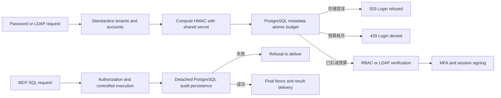

# AgentSQL v1.4.0 Multi-instance reliability design

**Language:** [English](v1.4.0-design.md) | [Simplified Chinese](../v1.4.0-design.md)

## User scenarios and goals

The target enterprise deployment will connect the two gateway nodes to the same PostgreSQL metadata and audit library to restore services after node failure. The password/LDAP login attempt budget of v1.1.0 is stored in the memory of each node. Rotating nodes can bypass the restriction of the same account. v1.4.0 changed this budget to shared, atomic control plane capabilities, and used a two-node real failure drill to verify the relationship between query delivery and persistent auditing. Target users and value are still product assumptions; there is no paid pilot feedback yet.

## must be delivered

1. Console passwords and LDAP logins in PostgreSQL metadata deployments use a shared attempt budget. Keys are computed HMAC using deployment key from normalized tenant and account name, clear text account is not saved; up to 10 times within fixed 60 second window from first attempt. Simultaneous requests from two nodes accumulate to the same budget and will not be reset when the node restarts. Login fails and is closed when metadata is unavailable; error responses do not reveal whether the account exists.
2. SQLite single node continues to use the original local budget. The multi-node deployment contract requires shared PostgreSQL metadata/audit, different `instance_id`, consistent keys and configurations; the document provides pre-upgrade checks, stop-flow switching sequence and fallback data boundaries.
3. Verified on two gateway nodes and separate PostgreSQL metadata/audit: the audit of allowed/denied requests is persisted before the results are delivered; after one node is interrupted, the audit library is temporarily unavailable and restored, the requests of the remaining nodes still make security decisions based on the control plane and audit status; after restarting, the audit chain, outbox delivery status and affected requests can be reviewed. Historical chain anomalies can only be reported and manually restored, and audit records cannot be automatically tampered with.
4. The migration adds new shared login budget storage and necessary indexes, covering SQLite/merged PostgreSQL/separated metadata upgrades, read-only `migrate --check`, backup recovery and rollback instructions. The audit library schema does not change due to login budget.
5. Maintains v1.3.0 database support boundaries; multi-node validation only covers the specified PostgreSQL control plane topology and does not extend vendor certification or full production support statements for each business database.

## Can be postponed

- Migrate ongoing B5 physical transactions or MCP transfer sessions across nodes.
- Commercial load balancer, cross-region strong consistency, automatic database failover, vendor HA certification.
- A new operation and maintenance dashboard is added to the console. Existing 429/503 feedback and audits/metrics are sufficient to support this version of the diagnostic.

## Interfaces and fault boundaries

Shared login budgets are stored atomically by metadata and limits are adjudicated by the same database transaction. Shared budget query is limited to 5 seconds; database disconnection or network black hole will return 503 after timeout, and login requests cannot be allowed to wait unbounded. The cleanup due budget line must be bounded, and unknown account requests are not allowed to grow indefinitely. Password verification, MFA consumption, and user queries inherit existing ordering and tenant constraints; database errors must not be downgraded to local counts. The operation and maintenance recovery drill also records the visible results of the client, audit ID, chain status and outbox status, so that service availability is not misjudged as audit success.

During the upgrade, the v1.3.0 node and the v1.4.0 node cannot be allowed to accept login traffic at the same time: the old node still uses the local budget. During the maintenance window, first stop the old node login portal, complete the complete set of backups and metadata migration, then start the two v1.4.0 nodes and perform cross-node budget re-verification. Rollback can only stop the new node and restore the pre-upgrade metadata/audit suite of snapshots and old programs; downgrading the binary alone is not supported.

Negative use cases include: two nodes guessing the same account at the same time, switching account case, cross-tenant requests, node restarts, metadata disconnection, unknown accounts occupying a large number of buckets, audit library pause, node exit, audit chain after recovery, and outbox review. Inconsistency of shared keys across nodes is a deployment error and must be rejected or discovered in preflight; it is not considered an automatically recoverable throttling state.

## Publishing standards

| threshold | Evidence of acceptance |
| --- | --- |
| Shared login budget | Two independent processes use the same PostgreSQL metadata, and both are rejected after a total of 10 times; concurrency competition, restart, time window, case, tenant isolation and storage failure testing. |
| Multi-node audit recovery | Separate the metadata/audit real database to perform allow, deny, node interruption, audit disconnection, and recovery; check result delivery, persistent audit, chain verification and outbox, and there will be no unaudited sensitive results delivered. |
| Compatibility and migration | v1.3.0 officially released the package to v1.4.0: SQLite and PostgreSQL sub-database upgrade/backup recovery, `migrate --check`, old version startup protection. |
| Delivery | Go/Web/Secure CI, signed dual-architecture release, GHCR accurate version dual-architecture anonymous pull, independent GitHub tag and official Release. The official website, public network Demo and `latest` remain v1.0.0, waiting for v1.5.0 to be updated uniformly. |

When any shared budget or audit failure drill fails to demonstrate failed shutdown, the multi-instance path is not declared accepted.
