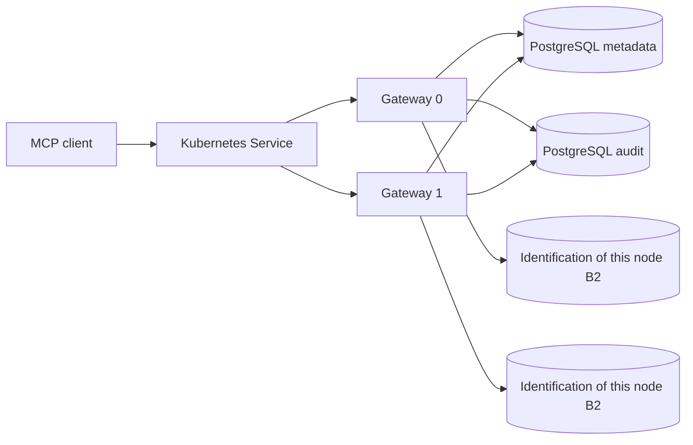

# AgentSQL v2.0.0 dual gateway Kubernetes design

**Language:** [English](v2.0.0-design.md) | [Simplified Chinese](../v2.0.0-design.md)

Status: Candidate implementation and isolation dual-node acceptance completed; official release must pass the sealing CI, signature assets and public network acceptance.

## User tasks and scope

The goal is to allow enterprise operations personnel to deploy two AgentSQL gateways in Kubernetes so that stateless MCP read-only requests can continue to be processed under control by the other gateway when a single gateway fails. The two replicas share PostgreSQL metadata and independent audit databases; migrations are performed explicitly by operations, and only the least privileged account and `auto_migrate:false` are used to run the replicas. v1.4.0 has verified that PostgreSQL dual-process shared login budget and audit faults are closed. This version completes deployment, upgrade rollback and fault drills.

This release's first dual-gateway configuration is limited to stateless MCP requests that pin two replicas. The physical connection and WAL of B5 session transactions are node-local; dual-gateway configurations explicitly shut down B5 before verifying node affinity routing, owner epoch, and WAL recovery. HTTP MCP status session and event resumption are also turned off in this configuration. Single-node native capabilities maintain their original deployment contracts; Kubernetes dual-gateway configurations do not automatically inherit their support claims.

## Safety and Operations Contract

| focus | design decisions | failure behavior |
| --- | --- | --- |
| Identity and tenants | Share the same `AGENTSQL_SECRET`, PostgreSQL metadata, Agent/personnel authorization, and separate audit library; running keys are injected by Kubernetes Secret and are not written to the ConfigMap. | It will not start when the Secret is missing or inconsistent; cross-Agent/tenant negative use cases must be re-verified. |
| B2 instance identity | Each StatefulSet ordinal uses an independent PVC to persist `instance_id_file`. Never share the same instance file or local WAL. | The B2 capability must be denied when the PVC is unwritable, has duplicate instance identifiers, or the lease is abnormal, and cannot be downgraded to column-less authorization query. |
| stateless routing | `mcp.http.stateful:false`、`event_store_enabled:false`、`mcp.sessions.enabled:false`、`mcp.transactions.postgres:false`。 | If the client requires session, event recovery or B5, it will return unsupported or rejected according to the protocol; it will not pretend to be a cross-node continuation. |
| request budget | The current common MCP Agent QPS current limit is calculated per process. It is fixed that each configuration of the two replicas does not exceed half of the declared cluster QPS, and the aggregation upper bound does not exceed the declared value; uneven distribution may limit the flow in advance. | There is no automatic expansion; the budget needs to be recalculated and accepted before changing the number of replicas. |
| Auditing and dependencies | The running copy must be connected to metadata and audit; `/readyz` is admitted as a Service, and `/healthz` survives as a process. | Controlled requests are rejected when audit/metadata fails; delivery is resumed only after the audit is restored. Local caching must not be considered persistent auditing. |
| Migrations and versions | Migration Job uses DDL credentials alone, running replica only performs read-only `agentsqlctl migrate --check`; set of backups of both PostgreSQL libraries. B2 runtime verification binary digest, cross versions cannot be active at the same time: fixed `OnDelete`, upgrade must stop both copies during the maintenance window and wait for the old lease to expire before starting the new version. | Pods are unavailable when the schema is missing, lagging, or ahead; new replicas refuse to be ready when binary digests are mixed. Stop switching and restore by snapshot. |

## Delivery content

1. Fixed-version Kubernetes manifest: ConfigMap, dual-copy StatefulSet, ClusterIP Service, PDB, node dispersion constraints, persistent volumes, resource requests and limits, non-root security context, health probes, Secret references.
2. Review scripts and operational documentation before migration and deployment. Check the PostgreSQL dual database, schema, secret name, fixed copy and deployment mode without displaying the credential content.
3. Management and operation instructions: Each node version, instance ID, readiness/audit status positioning; clarify the Service aggregation perspective and single node diagnosis perspective.
4. Two-node real test acceptance: allow/deny/masking/persistent audit, two-node polling, single Pod failure, metadata/audit failure shutdown and recovery, maintenance window upgrade and v1.9.0 official package rollback, complete backup recovery.

## Release thresholds and boundaries

It is necessary to obtain Go/Web/vulnerability check CI of the same submission, real Kubernetes dual-node and PostgreSQL acceptance, v1.9.0 official version upgrade recovery, dual-architecture signature assets and anonymous image pull, GitHub Release, official website and Live Demo public network review. The topology used in the Live Demo must be stated truthfully, and the single-node demo cannot be used to replace the evidence of dual-node capabilities.

Does not include cross-region consistency, PostgreSQL automatic failover, B5 connection continuation across nodes, unlimited horizontal scaling, or production SLAs. Real customer scenarios and load data have not yet been obtained; public support only covers tested Kubernetes, PostgreSQL, and MCP client versions and topologies.
