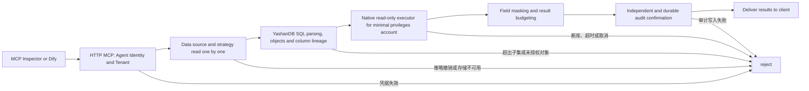

# AgentSQL v2.1.0: YashanDB YashanDB specified instance in-depth design

**Language:** [English](v2.1.0-design.md) | [Simplified Chinese](../v2.1.0-design.md)

Status: Design baseline, which must be revised based on the actual experimental acceptance results of this version. The last official version is [v2.0.0](v2.0.0-release-evidence.md). The user problem solved in this version is: Although the data source registered as `yashan` has native driver and narrow SELECT pipeline evidence, it cannot yet prove authorization, masking, persistent auditing and fault closure in a real HTTP MCP request with the same minimum privilege account. Without this combined link, administrators cannot tell whether what the AI ​​client reads is always a controlled result.

## Product positioning and scope

Bytebase's [ official SQL Editor introduces ](https://www.bytebase.com/sql-editor/) to use centralized authorization, dynamic masking and auditing as governance capabilities across multiple databases. This version of AgentSQL focuses on the sequential SQL requests of the AI ​​client and the reviewable security evidence of the specified version and specified mode of YashanDB; it does not replace database-by-database verification with the number of database registrations. The real customer pilot is still to be scheduled separately after the customer is confirmed.

Verified against locally provided YashanDB Enterprise Edition 23.4.1.109, `COMPAT_VECTOR=yashan`, `yashandb-go v1.4.4` and standalone C client 23.4.7.100. The official amd64/arm64 installation package and GHCR image need to confirm the driver, client and runtime loading respectively; the real database link is first verified on the x86_64 specified instance, and aarch64 server compatibility cannot be inferred based on this. Manufacturer C client redistribution only has verbal authorization records, and the repository does not have written authorization documents or certification numbers; it does not use the expression "manufacturer certification" or "full production support".

Supports scope maintenance of explicit column projection, single table, read-only SELECT subset of limited WHERE. Writes, transactions, EXPLAIN, complex JOINs, functions, system directories, and unvalidated TLS paths continue to be closed. If the instance cannot provide verifiable verification of the server certificate and client certificate, TLS is marked as unverified rather than silently downgraded.

## Request and failure to close link

All failure responses must not contain unmasked lines. The audit final state matches the allow or deny of client delivery; auditing cannot be written without delivering results. Native driver errors only output canonical code and stages, and do not echo DSNs, passwords, or native library diagnostics. The server's own read-only account should reject INSERTs, even if the gateway accidentally lets go of the statement as there is a second boundary.

## Development and acceptance thresholds

| Project | Verifiable completion conditions |
| --- | --- |
| real database and account | Isolate synthetic tables, unauthorized tables and read-only accounts; check server version, compatibility mode, client/driver identity and permission scope. The read-only account can SELECT the authorization table, but the server rejects INSERT; the SYS used for testing is only responsible for table creation and authorization, and does not become a business data source account. |
| Real MCP | The same read-only account is allowed through HTTP MCP, mobile phone number masking, R010 unauthorized table rejection and out-of-bounds SQL parsing rejection; MCP Inspector 0.16.8 and Dify 1.17.1 MCPClient actually call permission and rejection respectively, recording the client version, rules and audit ID. |
| Persistent auditing | Allows, Denies, and Errors are reconnectable for reads in the independent audit store; no original rows are delivered when an audit write fails, and new requests are still controlled after recovery. A memory audit of the test fixture must not be considered a pass for this item. |
| Permissions and glitches | Gateway policy revocation, database SELECT permission revocation, and business database disconnection/recovery pass respectively; timeout and client cancellation are recorded according to the actual performance of the driver. If it cannot be safely proven to stop execution, maintain a conservative shutdown and list the restrictions. |
| Compatible delivery | SQLite and PostgreSQL dual database upgrade, old package reading and complete backup recovery were carried out from the v2.0.0 official package data; the client dynamic library, version, anonymous pull and running smoke test of the new package amd64/arm64 and GHCR accurate tag passed. |
| Public network delivery | Independent CI, annotation tag, 15 signature assets, GHCR, official website PDF/copywriting, public network Demo candidate and switching, `latest` and post-release smoke test item-by-item records. Live Demo can continue to use synthetic PostgreSQL and does not imply the opening of commercial database instances on the public network. |

This version does not expand YashanDB's capabilities to batch writing or the full SQL dialect; a certain real database fault injection that cannot be completed must be marked as unverified and cannot be replaced by the passing results of other databases.
