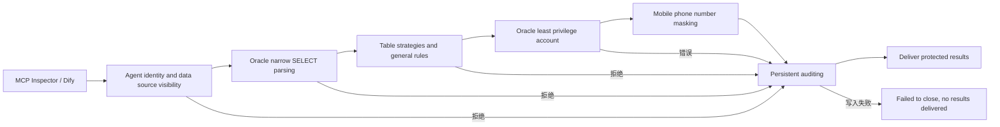

# AgentSQL v2.2.0 Design: Oracle designated instance controlled read-only closed loop

**Language:** [English](v2.2.0-design.md) | [Simplified Chinese](../v2.2.0-design.md)

Status: Under development. The target instance is the native Oracle AI Database 26ai Free, `FREEPDB1` service, server version `23.26.3.0.0`, and container image `container-registry.oracle.com/database/free@sha256:f988b0c04c4c386cd306a2a914c0d7a9702d83acc31b064a28ad8eb6278a8fba`. Oracle official description Free container's `FREEPDB1` is the default application PDB, and the `FREE` service connects to the root container; the versioned image is more suitable for reproduction than `latest`: [ container description ](https://container-registry.oracle.com/ords/ocr/ba/database/free), [ connection description ](https://docs.oracle.com/en/database/oracle/oracle-database/26/xeinw/connecting-oracle-database-xe.html). This machine `v$version` actually tested the above version; the release targets in this document do not replace the final acceptance record.

## goals and boundaries

| target | Delivery and Acceptance Method |
| --- | --- |
| true least privilege | Create a unique synthetic table in `FREEPDB1`, and only obtain temporary accounts for `CREATE SESSION` and target table `SELECT`; the Oracle server refuses to write, and no test accounts/objects remain after cleaning. The management account is only used for table creation, authorization, cancellation and cleanup. |
| controlled execution | Fixed single table, explicit column projection and SELECT subset of bounded WHERE; Oracle parser, gateway and real driver concatenation. Unvalidated structures, writes, transactions, functions, and multiple statements remain rejected. |
| Identity and Authorization | Use a real HTTP MCP Agent identity: permit the target table and reject unauthorized tables with R010. Revoking the Agent policy or Oracle table privileges must prevent raw rows from being delivered; repeat after restoring permissions. |
| masking and auditing | Synthetic mobile phone numbers are masked according to table rules; allow, deny, database error and preflight rejection are written to persistent auditing, and storage verification is reopened; the independent PostgreSQL audit library fails to close when it is shut down. |
| Business failures and clients | masking re-inspection after Oracle disconnection and recovery; MCP Inspector and Dify actually perform permission and R010 rejection respectively, and verify the audit. |
| release delivery | Version-by-version independent CI, v2.1.0 official package upgrade and complete set of backup and recovery, dual-architecture signature assets, GHCR three-type mirror, post-release inspection of GitHub Release, official website and Live Demo. Demo can continue to use its fixed synthetic PostgreSQL data, and Demo will not be mistakenly written as an Oracle real database display. |

## safety decision

- The Oracle `go-ora/v2` native connection is used with the existing read-only SQL access control, but the gateway's dialect whitelist and general rules must be explicitly connected to Oracle. Execution cannot be allowed just because a parser is parsable.
- Before the write ability of the least privileged account to `PLAN_TABLE` is verified, the pre-execution estimate that requires `EXPLAIN PLAN` is not used; static R010 refuses to no longer access the database for plan binding. The number of rows is still controlled by gateway enforcement limits. If the reviewable verification is completed with a dedicated plan object in the future, this capability will be independently expanded.
- Results for Oracle 26ai Free synthetic instances do not extrapolate to 19c, 23ai Commercial Edition, RAC, Data Guard, TCPS, production workloads, full SQL dialect, or vendor certifications. If any of the required safety closures fail, no new Oracle support announcement will be issued.
