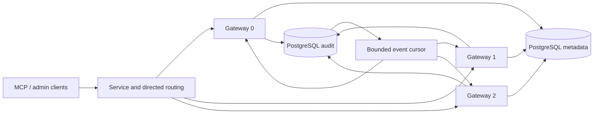

# AgentSQL v3.5.0 three-gateway and cross-instance delivery design

**Language:** [English](v3.5.0-design.md) | [Chinese](../v3.5.0-design.md)

Status: design candidate. A capability can ship only after its real topology, failure and upgrade gates below pass.

## Baseline and objective

The v2.4.0 Kubernetes sample fixes two gateways, disables stateful sessions, B5 transactions and event replay, and prevents different B2 versions from being active together. Its manifests still pin an older image. v3.5.0 uses shared PostgreSQL metadata, a separate PostgreSQL audit database and three independent gateways/PVCs as its acceptance topology. The objective is to observe durably committed audit events across nodes, define session ownership and failure behavior, and provide bounded upgrade and capacity procedures.

## Security contract

| Capability | Implementation boundary | Failure behavior |
| --- | --- | --- |
| Three replicas | Exactly three schedulable nodes, distinct instance ID/PVC per replica, identical security configuration and verified images; operators provide metadata and audit databases. | Duplicate instance ID, incompatible schema or secret, failed lease or audit dependency makes the node unready. |
| Cross-instance events | Allocate a per-tenant commit-order cursor inside each audit write transaction. Read bounded keyset pages from the audit store and resume from the tenant's last cursor. Historical and live events must be filtered by the authenticated tenant. Gateways emit only the existing safe projection, never raw SQL, secrets or result cells. | An expired cursor, gap, audit outage or subscriber backlog terminates the stream and directs clients to the authoritative audit API. Local SSE history is not a durable archive. |
| Session routing | Creation records owner, epoch and expiry. Only the current owner may continue after identity, tenant, continuation secret and epoch checks. An outer router uses a signed, non-secret owner hint; a misrouted node neither executes nor transparently replays. | Owner loss, routing drift or an epoch change denies continuation and ends/reaps the transaction. A database connection is never silently recreated on another node. |
| Capacity | Per-node pool, request concurrency, queue and SSE subscription limits are explicit; aggregate limits derive from the three node budgets. Evaluate P95, rejection rate, queue and audit lag as well as HTTP responses. | At capacity, return a clear limit/unavailable error without bypassing authorization, masking or durable audit. |
| Upgrade | Stateless traffic with unchanged schema/security contract may drain and replace nodes one by one. B2 binds versions, so mixed versions are denied by default; only a version pair with separate compatibility proof and live topology tests may coexist. | Without that proof, retain the maintenance window: stop all old B2 instances, wait for leases, then start the new version. Do not claim zero-downtime B2 rolling upgrade. |

## Acceptance gates

1. On an isolated three-node Kubernetes cluster and real PostgreSQL metadata/audit databases, verify distinct gateway identities, allow/deny/masking/durable audit, one Pod and one node failure, metadata/audit fail closure and recovery.
2. Observe the same committed audit event from admin SSE on different nodes and deduplicate by ID. Test tenant isolation for both history and live delivery, plus reconnect, pagination boundaries, lag and audit outage.
3. Continue a session on its owner; reject misrouting, cross-tenant access, stale epoch and vanished owner. Keep B5 disabled in deployment manifests if controlled B5 owner routing is not completed.
4. Exercise drain, one-at-a-time upgrade and rollback on the fixed stateless profile. Separately prove B2 compatibility or retain a full-stop maintenance window; stateless results cannot qualify B2 rolling upgrades.
5. Run bounded capacity checks and record allow/deny, audit completeness, P50/P95 and resources with three nodes and after one node fails. These numbers apply only to the isolated topology and are not a production SLA.

Formal release still requires full CI, signed dual-architecture assets, anonymous GHCR pulls, upgrade/rollback rehearsal and official site/public Demo acceptance. Disclose the Demo's actual topology; a single-node Demo is not three-node evidence.
