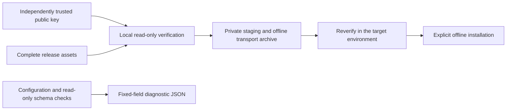

# AgentSQL v4.0.0 design

**Language:** [Simplified Chinese](../v4.0.0-design.md) | [English](v4.0.0-design.md)

This release completes the enterprise delivery and maintenance baseline in the ten-release v3.1.0–v4.0.0 plan. It serves administrators installing in isolated networks, upgrading across versions and sharing sanitized diagnostics. No customer production acceptance evidence exists, so it does not promise vendor certification, complete production support or a fixed contractual LTS term.

| User task | Deliverable | Acceptance boundary |
| --- | --- | --- |
| Verify offline installation provenance | `agentsqlctl release verify` and an offline transport assembly script | Independently trusted key, explicit version, 15 assets, three signatures, provenance and hashes must match; read-only, with no package execution. |
| Diagnose deployment issues | `agentsqlctl support-bundle` | Fixed JSON, 256 KiB output ceiling, 1 MiB config ceiling, read-only schema inspection and create-only output; no business data, credentials, addresses, logs or SQL. |
| Upgrade safely across versions | Three official-package upgrade paths, both store layouts, backup restore and old-binary rollback | Synthetic identities, permissions, masking, audit and encrypted fields are preserved; rollback restores complete backups, without in-place schema downgrade. |
| Understand support scope | Console guidance and bilingual maintenance manuals | Static product capability evidence is separate from current-instance diagnostics; database capabilities retain their individually verified boundaries. |

## Trust and data flow

The verifier rejects DEV keys, incorrect signatures, duplicate JSON fields or manifest lines, missing/extra assets, path traversal, symlinks, conflicting provenance versions and dirty builds. Package hashes are streamed with a 2 GiB limit; signed documents have a 32 MiB limit. Signatures establish issuance by the trusted key, not database production readiness. Establish key trust independently and keep files immutable between verification and installation.

## Compatibility and failure handling

Business permissions, MCP tools, B2/B5 transaction contracts and database capabilities do not expand. Schemas remain SQLite 27 and separated PostgreSQL metadata 25/audit 7. Cross-version maintenance requires stopping all writer instances and backing up SECRET, configuration, metadata, audit and applicable transaction recovery data; this guide does not establish safe mixed-version rolling upgrades.

Diagnostics reuse the fixed-field `doctor` report. Read-only checks may connect to configured metadata and audit stores, but do not probe business databases. Exit 0 means ready, 2 means migrations pending, and 1 means blocked; writing a diagnostic file does not establish readiness. Failed creation cannot overwrite an existing file. Discard an output left by a failed write and retry with a new path.

## Release gates

Main-branch CI, dual-architecture packages/signatures, network-disabled verification/installation, the upgrade matrix, exact GHCR tags, website PDFs and public Demo security smoke are accepted independently. Unfinished items remain unverified; see [acceptance](v4.0.0-acceptance.md) and [release evidence](v4.0.0-release-evidence.md).
