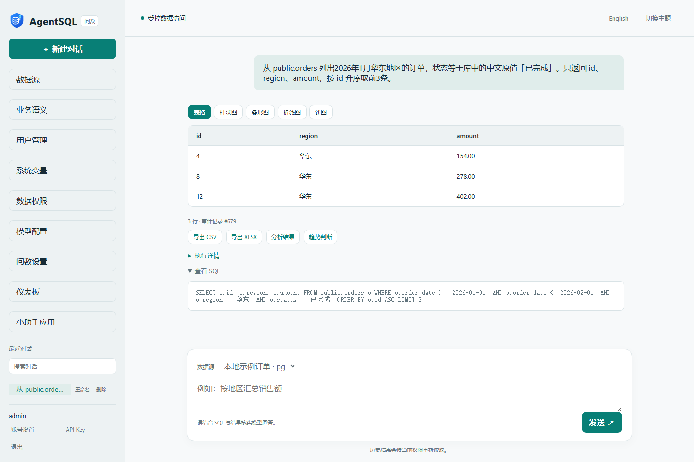
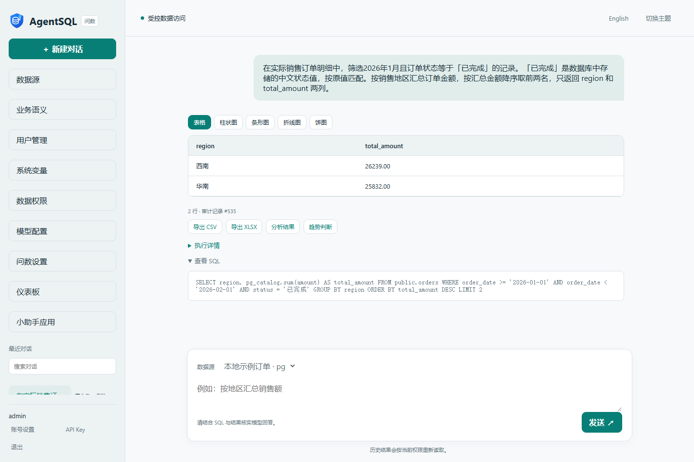

# AgentSQL v4.14.0 acceptance and scope

**Languages** [Chinese](../v4.14.0-acceptance.md) · [English](v4.14.0-acceptance.md)

**10/25 (40%)** cases passed in the fixed SQLBot Community v1.10.3 data Q&A matrix. The signed source revision is 3ce875104974a23f4f45ea4309b034ae01d286a1. This release adds Q2 single-table analysis and Q3 selection across 128 authorized tables. Testing used the native UI, the unmodified SQLBot Community v1.10.3 UI and its Python MCP SDK. [Release](https://github.com/cuipengdba/agentsql/releases/tag/v4.14.0) · [Exact-revision CI](https://github.com/cuipengdba/agentsql/actions/runs/45759437657) · [Scoring contract](sqlbot-community-chatbi-score-v1103.md)

## Real model and database

Windows Docker Desktop ran local Qwen3-4B Instruct 2507 (Q4_K_M, 4 CPUs and 8 GiB), the pinned ONNX model, the signed ChatBI and gateway executables, and a synthetic PostgreSQL 17.11 order database. The 128 explicitly authorized tables included forecasts, canceled orders, and 125 ledger distractors. One additional table remained inaccessible. Independent PostgreSQL queries confirmed values and ordering, and the controlled audit confirmed the actual query objects.

| Scenario | End-to-end seconds | Seconds before SQL inference | Gateway milliseconds | Audit |
| --- | ---: | ---: | ---: | ---: |
| Single-table filter | 101.06 | — | 4 | 229 |
| Group, order and limit | 109.59 | — | 4 | 48 |
| 128 tables, cold | 86.31 | 24.79 | 4 | 111 |
| 128 tables, warm | 108.78 | 15.46 | 4 | 209 |
| 128 tables, paraphrase | 112.97 | 15.12 | 6 | 183 |
| 128 tables, restarted | 40.98 | 16.04 | 7 | 255 |

These timings describe the measured samples. The time before SQL inference combines authorized metadata and table selection. It comes from the request and local model timestamps. Gateway latency comes from the query audit. The warm index reused all 128 encrypted vectors across a restart. Model interruption returned no data and initiated no query. Revoking the orders table invalidated old history, CSV, and Excel output. Canceling the initial index job left no partial vectors. [Single-table analysis and selection guide](v4.14.0-query-guide.md)

The signed package recorded 10 API probes, including 3 failures. The first cold attempt timed out at 199.06 seconds during concurrent installation testing, with no query or result. The first full prewarm reached its five-minute limit. Reopening the data-source list led to ready status after 36.38 seconds. Earlier candidate samples had prewarm timeouts, translated stored status values, and a wrong ledger selection for a paraphrased question. The accepted workload specified the date range and the Chinese value as stored in the database. The customer's business system and SQLBot Community v1.10.4 remain unverified. [SQLBot v1.10.4 release](https://github.com/dataease/SQLBot/releases/tag/v1.10.4)

## Browser, history, and MCP audits

- Filter, group, and select in the browser. Native audit IDs 697 / 505 / 542, unmodified SQLBot audit IDs 624 / 718 / 784.
- One conversation listed two order amounts by region. The follow-up summed the matching orders to 604730.00, audit IDs 1016 / 1035. A separate member received HTTP 404 for reading and HTTP 404 for deleting another user's history.
- After restart, the reopened history and both exports had audit IDs 417 / 424 / 431. After revocation, audit IDs 438 / 445 / 452 recorded deny decisions. Both exports were rejected.
- Native chart switching and reopening had audit ID 733. The unmodified client displayed a multi-measure chart with audit ID 829.
- Non-streaming and streaming calls from the original Python MCP SDK both counted 2400 orders, audit IDs 847 and 865.

The verified follow-up lists orders filtered by region and then sums matching amounts. Both turns use a fully qualified table name without a table alias. Another follow-up asking about “the same table as before” with a new filter selected an authorized forecast table, as shown in audit 902. A separate count-to-count follow-up dropped the prior region filter. Those cases remain outside the verified scope.

## Chinese screenshots

The single-table screenshot shows a reopened native conversation. The selection screenshot shows the live native answer across 128 authorized tables.

## Install and release assets

An independent trusted public key verified the 17 signed assets and the signed outer offline bundle. AMD64 and QEMU ARM64 passed network-isolated PID 1 systemd installation, upgrade from v4.13.0, and rollback after an injected first-start failure. The ARM64 test used emulation. The public Demo uses a simulated Q&A model. [Offline bundle](https://github.com/cuipengdba/agentsql/releases/download/v4.14.0/agentsql-v4.14.0-offline.tar.gz)

## Scores by case

| Scenario | Result | Evidence |
| --- | --- | --- |
| Q1 | Pass | [Client and audit results](#client-evidence) |
| Q2 | Pass | [Client and audit results](#client-evidence) |
| Q3 | Pass | [Client and audit results](#client-evidence) |
| Q4 | Unscored for this release | — |
| Q5 | Unscored for this release | — |
| Q6 | Unscored for this release | — |
| H1 | Pass | [Client and audit results](#client-evidence) |
| H2 | Pass | [Client and audit results](#client-evidence) |
| H3 | Pass | [Client and audit results](#client-evidence) |
| H4 | Pass | [Client and audit results](#client-evidence) |
| V1 | Pass | [Client and audit results](#client-evidence) |
| V2 | Pass | [Client and audit results](#client-evidence) |
| V3 | Unscored for this release | — |
| V4 | Unscored for this release | — |
| S1 | Unscored for this release | — |
| S2 | Unscored for this release | — |
| S3 | Unscored for this release | — |
| D1 | Unscored for this release | — |
| D2 | Unscored for this release | — |
| D3 | Unscored for this release | — |
| D4 | Unscored for this release | — |
| I1 | Pass | [Client and audit results](#client-evidence) |
| I2 | Unscored for this release | — |
| I3 | Unscored for this release | — |
| I4 | Unscored for this release | — |
