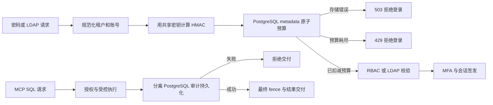

# AgentSQL v1.4.0 多实例可靠性设计

**语言 / Language:** [简体中文](v1.4.0-design.md) | [English](en/v1.4.0-design.md)

## 用户场景与目标

目标企业部署会把两个网关节点接到同一 PostgreSQL 元数据和审计库，以便节点故障后恢复服务。v1.1.0 的密码/LDAP 登录尝试预算保存在各节点内存里，轮换节点可以绕过同一账号的限制。v1.4.0 将该预算改为共享、原子的控制面能力，并用双节点真实故障演练验证查询交付与持久审计的关系。目标用户和价值仍是产品假设；尚无付费试点反馈。

## 必须交付

1. PostgreSQL 元数据部署中的控制台密码和 LDAP 登录使用共享尝试预算。键由规范化租户和账号名使用部署密钥计算 HMAC，不保存明文账号；从首次尝试起的 60 秒固定窗口内最多 10 次。两个节点的同时请求累计到同一预算，节点重启不重置。元数据不可用时登录失败关闭；错误响应不暴露账号是否存在。
2. SQLite 单节点继续使用原有本地预算。多节点部署合同要求共享 PostgreSQL metadata/audit、不同 `instance_id`、一致的密钥与配置；文档给出升级前检查、停流切换顺序和回退数据边界。
3. 在两个网关节点和分离的 PostgreSQL metadata/audit 上验证：允许/拒绝请求的审计先于结果交付持久化；一个节点中断、审计库暂时不可用及恢复后，剩余节点的请求仍按控制面与审计状态作出安全决策；重启后可复核审计链、outbox 投递状态和受影响请求。历史链异常只能报告与人工恢复，不能自动篡改审计记录。
4. 迁移新增共享登录预算存储及必要索引，覆盖 SQLite/合并 PostgreSQL/分离 metadata 的升级、只读 `migrate --check`、备份恢复和回退说明。审计库 schema 不因登录预算改变。
5. 保持 v1.3.0 数据库支持边界；多节点验证仅覆盖指定 PostgreSQL 控制面拓扑，不扩展各业务数据库的厂商认证或完整生产支持声明。

## 可延后

- 跨节点迁移正在进行的 B5 物理事务或 MCP 传输会话。
- 商业负载均衡器、跨地域强一致、自动数据库故障切换、厂商 HA 认证。
- 控制台中新增运维仪表板。现有 429/503 反馈和审计/指标足以支撑本版诊断。

## 接口与故障边界

共享登录预算由 metadata 存储原子计数，限额由同一数据库事务裁定。共享预算查询限定 5 秒；数据库断连或网络黑洞均在超时后返回 503，不能让登录请求无界等待。清理到期预算行必须有界，不允许未知账号请求无限增长。密码校验、MFA 消耗与用户查询沿用现有顺序和租户约束；数据库错误不得降级到本地计数。运维恢复演练同时记录客户端可见结果、审计 ID、链状态和 outbox 状态，不把服务可达误判为审计成功。

升级期间不能让 v1.3.0 节点和 v1.4.0 节点同时承接登录流量：旧节点仍采用本地预算。维护窗口中先停止旧节点登录入口，完成成套备份与 metadata 迁移，再启动两个 v1.4.0 节点并做跨节点预算复验。回退只能停止新节点并恢复升级前 metadata/audit 成套快照及旧程序；单独降级二进制不受支持。

负向用例包括：两个节点同时猜同一账号、切换账号大小写、跨租户请求、节点重启、metadata 断连、未知账号大量占用桶、审计库停顿、节点退出、恢复后审计链和 outbox 复核。共享密钥跨节点不一致属于部署错误，必须在预检中拒绝或发现；不把它视作可自动恢复的限流状态。

## 发布标准

| 门槛 | 验收证据 |
| --- | --- |
| 共享登录预算 | 两个独立进程使用同一 PostgreSQL metadata，累计 10 次后均拒绝；并发竞争、重启、时间窗、大小写、租户隔离及存储故障测试。 |
| 多节点审计恢复 | 分离 metadata/audit 真库，执行允许、拒绝、节点中断、审计断连、恢复；核对结果交付、持久审计、链校验和 outbox，不出现未审计的已交付敏感结果。 |
| 兼容与迁移 | v1.3.0 正式发行包至 v1.4.0：SQLite 与 PostgreSQL 分库升级/备份恢复、`migrate --check`、旧版本启动保护。 |
| 交付 | Go/Web/安全 CI、签名双架构发行物、GHCR 精确版本双架构匿名拉取、独立 GitHub tag 和正式 Release。官网、公网 Demo 与 `latest` 保持 v1.0.0，待 v1.5.0 统一更新。 |

任一共享预算或审计故障演练不能证明失败关闭时，不宣称该多实例路径完成验收。
