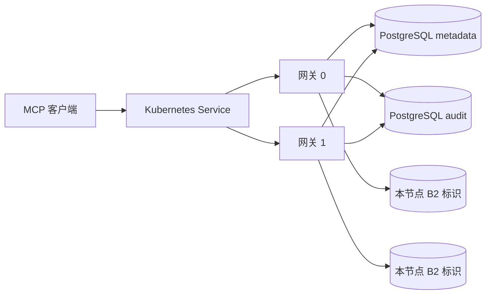

# AgentSQL v2.0.0 双网关 Kubernetes 设计

状态：候选实现及隔离双节点验收完成；正式发布须再通过封版 CI、签名资产与公网验收。

## 用户任务与范围

目标是让企业运维人员在 Kubernetes 中部署两个 AgentSQL 网关，使无状态 MCP 只读请求在单个网关故障时继续经另一个网关受控处理。两个副本共享 PostgreSQL metadata 和独立 audit 数据库；迁移由运维明确执行，运行副本仅使用最小权限账号且 `auto_migrate:false`。v1.4.0 已验证 PostgreSQL 双进程共享登录预算与审计故障关闭，本版补齐部署、升级回滚及故障演练。

本版首个双网关配置限定为固定两个副本的无状态 MCP 请求。B5 会话事务的物理连接和 WAL 属于节点本地状态；在验证节点亲和路由、owner epoch 与 WAL 恢复前，双网关配置明确关闭 B5。HTTP MCP 状态会话与事件续传也在该配置关闭。单节点原有能力保持原来的部署合同；Kubernetes 双网关配置不会自动继承其支持声明。

## 安全与运行合同

| 关注点 | 设计决定 | 失败行为 |
| --- | --- | --- |
| 身份与租户 | 共享同一 `AGENTSQL_SECRET`、PostgreSQL metadata、Agent/人员授权和单独审计库；运行密钥由 Kubernetes Secret 注入，不写入 ConfigMap。 | Secret 缺失或不一致时不启动；跨 Agent/租户负向用例必须复验。 |
| B2 实例身份 | 每个 StatefulSet ordinal 使用独立 PVC，持久保存 `instance_id_file`。绝不共享同一实例文件或本地 WAL。 | PVC 不可写、重复实例标识或租约异常时必须拒绝 B2 能力，不能降级为无列授权查询。 |
| 无状态路由 | `mcp.http.stateful:false`、`event_store_enabled:false`、`mcp.sessions.enabled:false`、`mcp.transactions.postgres:false`。 | 客户端若要求会话、事件恢复或 B5，按协议返回不支持或拒绝；不伪装为跨节点续接。 |
| 请求预算 | 当前普通 MCP Agent QPS 限流按进程计算。固定两副本各配置不超过声明集群 QPS 的一半，聚合上界不超过声明值；分布不均可能提前限流。 | 不自动扩容；改变副本数前需重新计算预算并验收。 |
| 审计与依赖 | 运行副本必须连通 metadata 和 audit；`/readyz` 作为 Service 准入，`/healthz` 作为进程存活。 | audit/metadata 故障时拒绝受控请求；审计恢复后才恢复交付。不得把本地缓存视为持久审计。 |
| 迁移与版本 | 迁移 Job 单独使用 DDL 凭据，运行副本仅执行只读 `agentsqlctl migrate --check`；两个 PostgreSQL 库成套备份。B2 运行时校验二进制摘要，跨版本不能同时活跃：固定 `OnDelete`，升级须在维护窗口停止两个副本并等旧租约过期后再启动新版。 | schema 缺失、落后或超前时 Pod 不可用；混合二进制摘要时新副本拒绝就绪。停止切换并按快照恢复。 |

## 交付内容

1. 版本固定的 Kubernetes 清单：ConfigMap、双副本 StatefulSet、ClusterIP Service、PDB、节点分散约束、持久卷、资源请求和限制、非 root 安全上下文、健康探针、Secret 引用。
2. 迁移及部署前检查脚本与操作文档。检查 PostgreSQL 双库、schema、Secret 名称、固定副本和部署模式，不显示凭据内容。
3. 管理与运维说明：每节点版本、实例 ID、就绪/审计状态定位；明确 Service 聚合视角与单节点诊断视角。
4. 双节点真实验收：允许/拒绝/脱敏/持久审计、两节点轮询、单 Pod 故障、metadata/audit 故障关闭与恢复、维护窗口升级和 v1.9.0 正式包回退、成套备份恢复。

## 发布门槛及边界

必须取得同一提交的 Go/Web/漏洞检查 CI、真实 Kubernetes 双节点和 PostgreSQL 验收、v1.9.0 正式版升级恢复、双架构签名资产与匿名镜像拉取、GitHub Release、官网和 Live Demo 公网复核。Live Demo 采用何种拓扑须照实说明，不能以单节点 Demo 代替双节点能力证据。

不包含跨区域一致性、PostgreSQL 自动故障转移、B5 连接跨节点续接、无限水平扩容或生产 SLA。真实客户场景和负载数据尚未取得；公开支持范围仅覆盖已测试 Kubernetes、PostgreSQL、MCP 客户端版本及拓扑。
