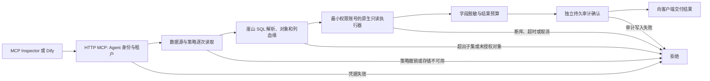

# AgentSQL v2.1.0：崖山 YashanDB 指定实例深化设计

**语言 / Language:** [简体中文](v2.1.0-design.md) | [English](en/v2.1.0-design.md)

状态：设计基线，须以本版真实验收结果修订。上一正式版是 [v2.0.0](v2.0.0-release-evidence.md)。本版解决的用户问题是：已登记为 `yashan` 的数据源虽有原生驱动和窄 SELECT 流水线证据，但尚不能凭同一个最小权限账号，在真实 HTTP MCP 请求中同时证明授权、脱敏、持久审计与故障关闭。没有这条组合链路，管理员无法判断 AI 客户端读到的是否始终是受控结果。

## 产品定位与范围

Bytebase 的[官方 SQL Editor 介绍](https://www.bytebase.com/sql-editor/)将集中授权、动态脱敏和审计作为跨多数据库的治理能力。AgentSQL 本版聚焦 AI 客户端的逐次 SQL 请求，以及崖山指定版本、指定模式的可复核安全证据；不以数据库注册数量替代逐库验证。真实客户试点仍待客户确定后另行排期。

验证对象是本地提供的 YashanDB Enterprise Edition 23.4.1.109，`COMPAT_VECTOR=yashan`，`yashandb-go v1.4.4` 和独立 C 客户端 23.4.7.100。正式 amd64/arm64 安装包及 GHCR 镜像需各自确认驱动、客户端和运行时加载；真库链路首先在 x86_64 指定实例验证，不能据此推断 aarch64 服务端兼容。厂家 C 客户端再分发只有既有口头授权记录，仓库没有书面授权文件或认证编号；不使用“厂商认证”或“完整生产支持”表述。

支持范围维持明确列投影、单表、有限 WHERE 的只读 SELECT 子集。写入、事务、EXPLAIN、复杂 JOIN、函数、系统目录和未经验证的 TLS 路径继续关闭。若实例不能提供可验证的服务器证书与客户端证书校验，TLS 标为未验证而非静默降级。

## 请求与失败关闭链路

所有故障响应不得包含未脱敏行。审计终态与对客户端交付的允许或拒绝相匹配；不能写审计时不交付结果。原生驱动错误仅输出规范化代码与阶段，不回显 DSN、口令或原始库诊断。服务器自身的只读账号应拒绝 INSERT，即使网关意外放开语句也有第二道边界。

## 开发和验收门槛

| 项目 | 可核查的完成条件 |
| --- | --- |
| 真库与账号 | 隔离合成表、未授权表和只读账号；核对服务端版本、兼容模式、客户端/驱动身份及许可范围。只读账号能 SELECT 授权表，服务器拒绝 INSERT；测试用 SYS 仅负责建表和授权，不成为业务数据源账号。 |
| 真实 MCP | 同一只读账号经 HTTP MCP 完成允许、手机号脱敏、R010 未授权表拒绝和越界 SQL 解析拒绝；MCP Inspector 0.16.8 与 Dify 1.17.1 MCPClient 各自实际调用允许与拒绝，记录客户端版本、规则和审计 ID。 |
| 持久审计 | 允许、拒绝和错误在独立审计存储中可重新连接读取；审计写入故障时无原始行交付，恢复后新请求仍受控。不得把测试夹具的内存审计当成此项通过。 |
| 权限与故障 | 网关策略撤销、数据库 SELECT 权限撤销、业务库断线/恢复分别通过；超时和客户端取消按驱动实际表现记录，若不能安全证明停止执行，维持保守关闭并列明限制。 |
| 兼容交付 | 从 v2.0.0 正式包数据进行 SQLite 与 PostgreSQL 双库升级、旧包读取和成套备份恢复；新包 amd64/arm64 及 GHCR 精确 tag 的客户端动态库、版本、匿名拉取和运行烟测通过。 |
| 公网交付 | 独立 CI、注释 tag、15 项签名资产、GHCR、官网 PDF/文案、公网 Demo 候选与切换、`latest` 和发布后烟测逐项记录。Live Demo 可继续使用合成 PostgreSQL，不暗示公网开放商业数据库实例。 |

本版不扩大崖山能力到批量写入或完整 SQL 方言；无法完成的某项真库故障注入必须写明为未验证，不能用其他数据库的通过结果代替。
