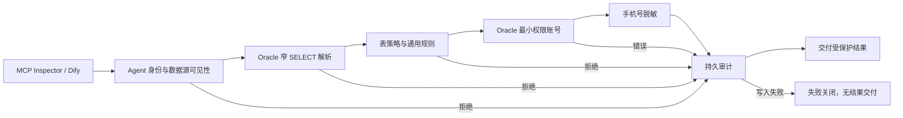

# AgentSQL v2.2.0 设计：Oracle 指定实例受控只读闭环

**语言 / Language:** [简体中文](v2.2.0-design.md) | [English](en/v2.2.0-design.md)

状态：开发中。目标实例为本机 Oracle AI Database 26ai Free、`FREEPDB1` 服务、服务端版本 `23.26.3.0.0`，容器镜像 `container-registry.oracle.com/database/free@sha256:f988b0c04c4c386cd306a2a914c0d7a9702d83acc31b064a28ad8eb6278a8fba`。Oracle 官方说明 Free 容器的 `FREEPDB1` 是默认应用 PDB，而 `FREE` 服务连接根容器；版本化镜像比 `latest` 更适合复现：[容器说明](https://container-registry.oracle.com/ords/ocr/ba/database/free)、[连接说明](https://docs.oracle.com/en/database/oracle/oracle-database/26/xeinw/connecting-oracle-database-xe.html)。本机 `v$version` 实测上述版本；本文件中的发布目标不替代最终验收记录。

## 目标与边界

| 目标 | 交付与验收方法 |
| --- | --- |
| 真实最小权限 | 在 `FREEPDB1` 建立唯一合成表、仅获 `CREATE SESSION` 和目标表 `SELECT` 的临时账号；由 Oracle 服务端拒绝写入，清理后无测试账号/对象残留。管理账号只用于建表、授权、撤销与清理。 |
| 受控执行 | 固定单表、明确列投影和有界 WHERE 的 SELECT 子集；Oracle parser、网关与真实驱动串联。未验证结构、写入、事务、函数和多语句保持拒绝。 |
| 身份与授权 | 真实 HTTP MCP Agent 身份，目标表允许、无权表 R010 拒绝；撤销 Agent 策略和 Oracle 表权限后均不交付原始行，恢复后重验。 |
| 脱敏与审计 | 合成手机号按表列规则遮蔽；允许、拒绝、数据库错误与预检拒绝写入持久审计，并重新打开存储验证；独立 PostgreSQL 审计库停机时失败关闭。 |
| 业务故障与客户端 | Oracle 断连及恢复后脱敏复验；MCP Inspector 和 Dify 分别真实执行允许与 R010 拒绝，并核对审计。 |
| 发布交付 | 逐版独立 CI、v2.1.0 正式包升级及成套备份恢复、双架构签名资产、GHCR 三类镜像、GitHub Release、官网和 Live Demo 的发布后检查。Demo 可继续使用其固定合成 PostgreSQL 数据，不把 Demo 误写成 Oracle 真库展示。 |

## 安全决定

- Oracle `go-ora/v2` 原生连接与已有只读 SQL 门禁沿用，但网关的 dialect 白名单和泛用规则须明确接入 Oracle。不能仅因 parser 可解析而允许执行。
- 最小权限账号对 `PLAN_TABLE` 的写入能力未验证前，不使用需要 `EXPLAIN PLAN` 的预执行估算；静态 R010 拒绝不再为了计划绑定而触达数据库。行数仍由网关执行限额控制。若后续以专用计划对象完成可复核验证，再独立扩大此能力。
- Oracle 26ai Free 合成实例的结果不外推至 19c、23ai 商业版、RAC、Data Guard、TCPS、生产负载、完整 SQL 方言或厂商认证。任何一个必需的安全闭环失败，则不发布 Oracle 新支持声明。
