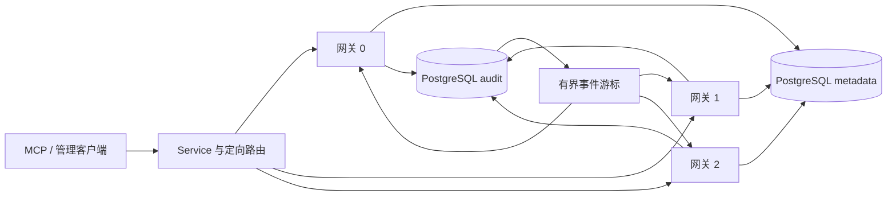

# AgentSQL v3.5.0 三网关与跨实例交付设计

**语言 / Language:** [简体中文](v3.5.0-design.md) | [English](en/v3.5.0-design.md)

状态：设计候选；只有下列真拓扑、故障与升级门槛全部通过后才可发布相应能力。

## 基线与目标

v2.4.0 的 Kubernetes 样例固定两个网关，关闭状态会话、B5 事务及事件续传，B2 不接受不同版本同时活跃；当前样例仍固定旧镜像。v3.5.0 以共享 PostgreSQL metadata、独立 PostgreSQL audit 和三个独立网关/PVC 为验收拓扑。目标是跨节点看到已经持久化的审计事件、明确会话归属与故障行为，并给出有边界的升级及容量操作流程。

## 安全合同

| 能力 | 实现边界 | 失败行为 |
| --- | --- | --- |
| 三副本 | 固定三个可调度节点、每副本独立实例 ID/PVC、相同安全配置与经核验的镜像；元数据及审计库由部署者提供。 | 实例 ID 重复、schema、密钥、租约或审计依赖不一致时节点不可就绪。 |
| 跨实例事件 | 以已经提交的 audit ID 为游标从审计库做有界 keyset 读取；客户端断线后可从最后 ID 续取，网关只输出既有安全字段投影，不转发原始 SQL、密钥或结果。 | 游标过旧、断档、审计库不可用或订阅积压时显式中断并引导权威审计 API 重取，不把本地 SSE 缓存伪装成可靠归档。 |
| 会话路由 | 会话创建时登记 owner、epoch 和到期时间；后续请求仅由当前 owner 在身份、租户、续接密钥及 epoch 全部一致时处理。外层路由按签名/不含秘密的 owner 提示定向；跨节点误投不能代执行或透明重放。 | owner 消失、路由漂移或 epoch 变化时拒绝续接并回收/终止事务；不在另一节点无声恢复数据库连接。 |
| 容量 | 每节点连接池、请求并发、队列及 SSE 订阅上限显式固定，聚合上限由三节点预算相加；以 P95、拒绝率、队列和审计延迟而非 HTTP 200 单项验收。 | 达到上限返回明确限流/不可用，不允许绕过权限、脱敏或持久审计。 |
| 升级 | 不改变 schema/安全合同的无状态流量可先摘流、排空、逐节点替换并复验。B2 有版本绑定，混合版本默认不允许；只有经过独立兼容证明及真拓扑测试的版本对才可混跑。 | 无兼容证明时保持现有维护窗口：全部旧 B2 实例退出、租约过期后启新版；不得宣称 B2 无停机滚动升级。 |

## 验收门槛

1. 在隔离三节点 Kubernetes 与真实 PostgreSQL 双库上验证每个网关独立身份、允许/拒绝/脱敏/持久审计、单 Pod 与单节点故障、metadata/audit 故障关闭及恢复。
2. 同一审计事件经不同节点的管理 SSE 被观察且按 ID 去重；断线续接、分页边界、滞后及审计不可用均做负向测试。
3. 会话在 owner 节点可续接，误路由、跨租户、旧 epoch、owner 故障及重启后不可静默接管；若本版未完成受控 B5 定向路由，部署清单继续关闭 B5。
4. 对固定无状态配置实测三节点排空/逐节点升级及回退；B2 开启场景另测版本兼容证明或维持全停维护，不以无状态结果代替 B2 滚动证据。
5. 进行有界容量测试，记录单节点及故障后剩余两节点的允许/拒绝、审计完整性、P50/P95 和资源占用；数值只用于该隔离拓扑，不宣称生产 SLA。

正式发布仍需整仓 CI、双架构签名资产、GHCR 匿名拉取、旧版升级/回退演练以及官网与公网 Demo 验收。Demo 的实际拓扑须如实标注，不能以单节点 Demo 替代三节点证据。
