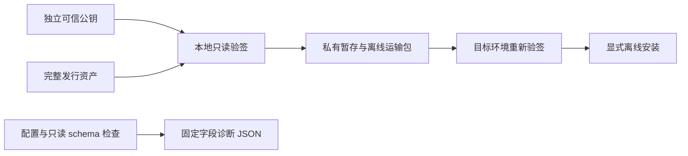

# AgentSQL v4.0.0 设计

**语言 / Language:** [简体中文](v4.0.0-design.md) | [English](en/v4.0.0-design.md)

本版承接 v3.1.0 至 v4.0.0 十版计划的企业交付与维护基线。目标用户是需要在隔离网络安装、跨版本升级和提交脱敏诊断的管理员；没有客户生产验收证据，因此不承诺厂商认证、完整生产支持或固定期限的 LTS 服务。

| 用户任务 | 交付 | 验收边界 |
| --- | --- | --- |
| 验证离线安装来源 | `agentsqlctl release verify` 与离线运输包组装脚本 | 独立受信公钥、显式版本、15 项资产、三份签名、来源与哈希全部匹配；只读，不执行包内代码。 |
| 排查部署问题 | `agentsqlctl support-bundle` | 固定 JSON、256 KiB 上限、配置 1 MiB 上限、只读 schema 检查、新文件输出；不导出业务数据、凭据、地址、日志或 SQL。 |
| 安全跨版本升级 | 三条正式包升级路径、双存储布局、备份恢复及旧程序回退 | 合成身份、授权、脱敏、审计和加密字段保留；回退恢复整套备份，不做原地 schema 降级。 |
| 理解产品支持范围 | 控制台操作指引和中英文维护手册 | 产品静态能力证据与当前实例诊断分开呈现，数据库能力沿用各自已验证边界。 |

## 信任与数据流

验签器拒绝 DEV 密钥、错误签名、重复 JSON 字段或清单行、缺失/额外文件、目录穿越、符号链接、来源版本冲突和脏构建。包哈希流式读取且限制为 2 GiB，签名文档限制为 32 MiB。签名证明文件由受信密钥签发，不证明数据库生产就绪；公钥必须经独立渠道确认。文件须在校验与安装间保持不变。

## 兼容与故障处理

业务权限、MCP 工具、B2/B5 事务合同与数据库能力不扩张。schema 保持 SQLite 27、分库 PostgreSQL metadata 25/audit 7。跨版本维护要求停止所有写入实例并备份 SECRET、配置、元数据、审计和适用的事务恢复数据；不允许借本版文档推断混合版本滚动升级安全。

诊断命令复用 `doctor` 的固定字段报告。只读检查可能连接已配置的元数据库与审计库，但不探测业务数据库。检查就绪返回 0、待迁移返回 2、受阻返回 1；成功写入诊断文件不等于实例就绪。创建文件失败不会覆盖旧文件，写入中途失败的文件须弃用并选新路径重试。

## 发布门槛

正式主分支 CI、双架构包与签名、禁网验证/安装、升级矩阵、GHCR 精确标签、官网 PDF、公网 Demo 安全烟测分别验收。未完成项保留待验证状态，结果见[验收](v4.0.0-acceptance.md)与[发布证据](v4.0.0-release-evidence.md)。
