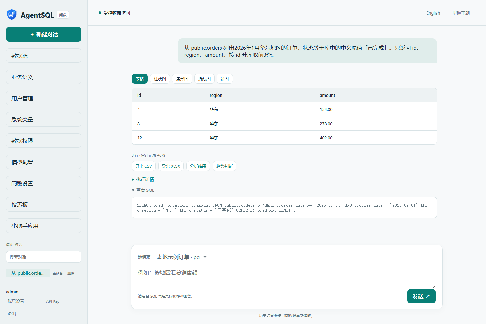
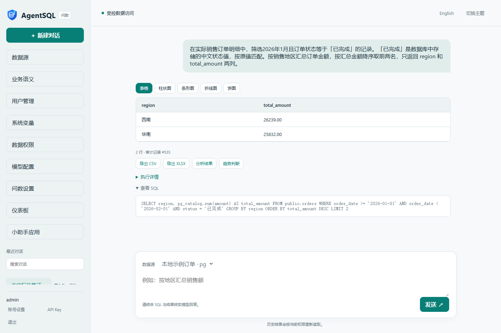

# AgentSQL v4.14.0 验收与范围

**语言 / Language** [简体中文](v4.14.0-acceptance.md) · [English](en/v4.14.0-acceptance.md)

已通过固定 SQLBot Community v1.10.3 问数矩阵 **10/25（40%）**。正式签名源码为 3ce875104974a23f4f45ea4309b034ae01d286a1。本版新增通过 Q2 单表分析和 Q3 128 张授权表选表。测试使用原生界面、未修改的 SQLBot Community v1.10.3 界面与 Python MCP SDK。 [正式发布](https://github.com/cuipengdba/agentsql/releases/tag/v4.14.0) · [精确提交 CI](https://github.com/cuipengdba/agentsql/actions/runs/45759437657) · [评分合同](sqlbot-community-chatbi-score-v1103.md)

## 真模型与数据库

在 Windows Docker Desktop 上使用本地 Qwen3-4B Instruct 2507（Q4_K_M，4 CPU、8 GiB）、固定 ONNX 模型、AgentSQL 同一签名包的问数与网关二进制及 PostgreSQL 17.11 合成订单库。128 张表均有显式授权，其中包括订单预测、取消归档及 125 张台账表。另有一张未授权表。SQL、查询对象、结果值和顺序与独立 PostgreSQL 计算核对。

| 场景 | 问数秒数 | 进入 SQL 推理前的秒数 | 网关毫秒 | 审计 |
| --- | ---: | ---: | ---: | ---: |
| 单表筛选 | 101.06 | — | 4 | 229 |
| 分组、排序与限量 | 109.59 | — | 4 | 48 |
| 128 表冷态 | 86.31 | 24.79 | 4 | 111 |
| 128 表热态 | 108.78 | 15.46 | 4 | 209 |
| 128 表热态改述 | 112.97 | 15.12 | 6 | 183 |
| 128 表重启后 | 40.98 | 16.04 | 7 | 255 |

这些时间是表中的实测样本。进入 SQL 推理前的时间来自问数请求和模型进程日志，包含授权元数据和选表。网关毫秒数来自对应执行审计。冷态无持久索引，热态已预热，重启后确认 128 条加密向量的存储清单一致。模型中断拒绝结果且无新查询。撤销订单表权限后，历史、CSV 和 Excel 旧结果均不再释放。索引任务取消后保留零条部分写入。 [单表与选表使用指南](v4.14.0-query-guide.md)

同一签名包共记录 10 次 API 测试，其中 3 次失败。首次冷态问数在同机进行安装验收时于 199.06 秒进入超时，未执行查询或返回结果。 首轮完整预热达到五分钟时限。再次打开数据源列表后，预热在 36.38 秒后进入 ready。 较早候选在共享机器上出现预热超时、中文状态值翻译和改述误选台账。正式验收使用明确的日期区间及数据库保存的中文原值。用户业务系统和 SQLBot Community v1.10.4 尚未验证。 [SQLBot v1.10.4 官方说明](https://github.com/dataease/SQLBot/releases/tag/v1.10.4)

## 页面、历史和 MCP 审计

- 页面筛选、分组与选表的审计编号。AgentSQL 原生页面 697 / 505 / 542，原版 SQLBot 页面 624 / 718 / 784。
- 同一会话先按地区列出两笔金额 154.00 / 278.00，追问返回同地区的金额合计 604730.00，审计 1016 / 1035。普通成员读取及删除他人历史分别收到 HTTP 404 和 404。
- 重启后的历史和两种导出审计为 417 / 424 / 431。撤权后对应的三条审计 438 / 445 / 452 均为 deny。两种导出均拒绝。
- 原生图表切换与重开、原版多指标图表分别核对审计 733 和 829。
- 原版 Python MCP SDK 非流式和流式均返回订单数 2400，审计 847 和 865。

已验多轮场景先按地区列明细，再用「这些订单」承接上轮范围汇总金额。两轮都使用完整表名且不使用表别名。一次「就刚才那张表」并新增过滤的追问误选有权的预测表，审计 902。另一次在聚合之后直接追问总数，未保留上一轮的地区筛选。发布范围以已通过的场景为准。

## 中文实拍

单表筛选截图来自原生问数历史的真实重开，128 表选表截图来自原生页面的当次回答。

## 安装与交付

17 项签名资产经独立可信公钥核验，外层一键离线包也已独立验签。AMD64 和 QEMU ARM64 在断网实际 PID 1 systemd 中验证了新装、v4.13.0 升级和首次启动失败回滚。ARM64 结果来自仿真环境。 公网 Demo 的问数模型仅作模拟展示。 [离线包](https://github.com/cuipengdba/agentsql/releases/download/v4.14.0/agentsql-v4.14.0-offline.tar.gz)

## 逐项评分

| 场景 | 结果 | 证据 |
| --- | --- | --- |
| Q1 | 通过 | [页面与实际审计](#client-evidence) |
| Q2 | 通过 | [页面与实际审计](#client-evidence) |
| Q3 | 通过 | [页面与实际审计](#client-evidence) |
| Q4 | 本版未计分 | — |
| Q5 | 本版未计分 | — |
| Q6 | 本版未计分 | — |
| H1 | 通过 | [页面与实际审计](#client-evidence) |
| H2 | 通过 | [页面与实际审计](#client-evidence) |
| H3 | 通过 | [页面与实际审计](#client-evidence) |
| H4 | 通过 | [页面与实际审计](#client-evidence) |
| V1 | 通过 | [页面与实际审计](#client-evidence) |
| V2 | 通过 | [页面与实际审计](#client-evidence) |
| V3 | 本版未计分 | — |
| V4 | 本版未计分 | — |
| S1 | 本版未计分 | — |
| S2 | 本版未计分 | — |
| S3 | 本版未计分 | — |
| D1 | 本版未计分 | — |
| D2 | 本版未计分 | — |
| D3 | 本版未计分 | — |
| D4 | 本版未计分 | — |
| I1 | 通过 | [页面与实际审计](#client-evidence) |
| I2 | 本版未计分 | — |
| I3 | 本版未计分 | — |
| I4 | 本版未计分 | — |
